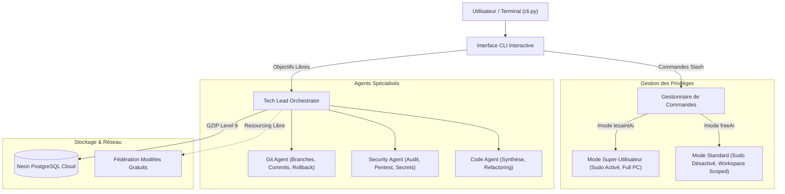

# Guide d'Utilisation Officiel - FreeAI Sovereign Assistant ⚡

Bienvenue dans le guide complet de **FreeAI**, l'assistant d'ingénierie et d'automatisation autonome souverain, conçu pour fonctionner en local avec resourcing libre dynamique et persistance cloud zéro-disque.

---

## 1. Introduction et Philosophie

FreeAI a été conçu selon des principes stricts de souveraineté, de frugalité matérielle et de puissance d'action :

- **Souveraineté & Priorité Locale** : Exécution prioritaire sur CPU local avec modèles quantifiés et agents autonomes spécialisés.
- **Resourcing Hybride Libre** : En cas de besoin de connaissances externes, FreeAI consulte dynamiquement des modèles ouverts gratuits sans coût d'API.
- **Mode NÉANT (Zero-Disk Footprint)** : Aucun fichier d'historique ou de cache n'est écrit sur le disque local dans les répertoires `memory/` et `logs/`. Toutes les opérations locales restent en RAM éphémère.
- **Mémoire Déportée Neon Cloud** : La mémoire essentielle est automatiquement filtrée, compressée avec **GZIP (niveau 9)** et stockée à distance dans PostgreSQL Neon Cloud.
- **Contrôle Granulaire des Privilèges** : Bascule dynamique et instantanée entre un mode standard confiné (`freeAi`) et un mode super-utilisateur sans restriction (`lesaintAi`).



---

## 2. Démarrage Rapide

### Prérequis
- Système d'exploitation Linux (testé et optimisé sous Kali Linux / Debian)
- Python 3.10+
- Dépendances installées via `requirements.txt` (`rich`, `psycopg2`, `fastapi`, `psutil`, etc.)

### Lancer la Console Interactive
Pour démarrer la console interactive avec l'invite dynamique et l'autocomplétion des commandes :

```bash
python3 cli.py
```

### Lancer en Mode Super-Utilisateur dès le départ
```bash
python3 cli.py --mode lesaintAi
```

### Exécuter un Objectif Direct (Mode Batch)
Vous pouvez également passer un objectif direct en argument sans entrer dans la boucle interactive :

```bash
# Vérifier l'état en une ligne
python3 cli.py /status

# Exécuter une recherche directe
python3 cli.py "/search *.conf /etc"

# Transmettre un objectif libre au Tech Lead
python3 cli.py "Audit des dépendances du projet et détection des vulnérabilités"
```

---

## 3. Les Modes de Privilèges (`/mode`)

FreeAI intègre un système de permissions à deux niveaux modifiable à chaud, sans redémarrer le programme.

| Caractéristique | Mode Standard (`freeAi`) | Mode Super-Utilisateur (`lesaintAi` ⚡) |
| :--- | :--- | :--- |
| **Commande d'activation** | `/mode freeAi` | `/mode lesaintAi` |
| **Invite du terminal** | `[FreeAI:freeAi] > ` | `[FreeAI:lesaintAi ⚡] > ` |
| **Privilèges Sudo** | ❌ **Désactivé** (`ALLOW_SUDO=False`) | ✔ **Activé** (`ALLOW_SUDO=True`) |
| **Périmètre d'écriture** | Confiné au workspace (`WORKSPACE_ROOT`) | 🌐 Tout le disque dur du PC |
| **Périmètre de lecture** | 🌐 Lecture globale du PC autorisée | 🌐 Lecture globale du PC autorisée |
| **Cas d'usage** | Développement quotidien, audits, scripts, refactoring | Tâches d'administration, installation de paquets root, modifications réseau |

### Comment basculer :
```text
[FreeAI:freeAi] > /mode lesaintAi
⚡ MODE SUPER-UTILISATEUR ACTIVÉ (lesaintAi) ⚡
• Privilèges sudo déverrouillés (ALLOW_SUDO=True)
• Écriture et exécution totale sur tout le système sans restriction

[FreeAI:lesaintAi ⚡] > /mode freeAi
🛡 MODE STANDARD SÉCURISÉ ACTIVÉ (freeAi)
• Privilèges sudo désactivés (Sudo bloqué)
• Écriture confinée au workspace du projet
```

> [!WARNING]
> En mode `lesaintAi`, FreeAI dispose des droits administrateurs complets. Veillez à vérifier les actions demandées pour éviter toute altération involontaire de fichiers système.

---

## 4. Référence Complète des Commandes Slash

L'interface de commande supporte l'autocomplétion via la touche `Tab` ainsi que l'historique via les flèches haut/bas.

### 4.1 `/mode [freeAi|lesaintAi]`
Affiche le mode en cours ou bascule instantanément vers le mode spécifié.
```text
/mode
/mode freeAi
/mode lesaintAi
```

---

### 4.2 `/status`
Affiche en direct un tableau de bord exhaustif du système et des services :
- **Mode actif et permissions** (Sudo, Écriture, Lecture globale).
- **Consommation RAM du processus IA** vs budget (3500 MB) et limite dure (4000 MB).
- **RAM globale du PC** (utilisée, disponible, totale).
- **Charge CPU instantanée**.
- **Mode mémoire local** : confirmation du Mode NÉANT (0 octet écrit sur disque).
- **État de la base Neon Cloud** : statut de connexion, nombre d'enregistrements de connaissances et d'audits, algorithme de compression.

**Exemple de sortie :**
```text
                        📊 État Global du Système FreeAI                        
┏━━━━━━━━━━━━━━━━━━━━━━━┳━━━━━━━━━━━━━━━━━━━━━━━━━━━━━━━━━━━━━━━━━━━━━━━━━━━━━━┓
┃ Composant             ┃ Valeur / État                                        ┃
┡━━━━━━━━━━━━━━━━━━━━━━━╇━━━━━━━━━━━━━━━━━━━━━━━━━━━━━━━━━━━━━━━━━━━━━━━━━━━━━━┩
│ Mode Actif            │ freeAi (Standard Sécurisé)                           │
│ Privilèges Sudo       │ Désactivé (Sudo Bloqué)                              │
│ Périmètre Écriture    │ Confiné au Workspace                                 │
│ Lecture Globale PC    │ Autorisée                                            │
│ Workspace             │ /home/lesaint/Rendue/FreeAi                          │
│ RAM Processus IA      │ 69.9 MB / Budget: 3500 MB (Max: 4000 MB)             │
│ RAM Système           │ Utilisée: 4460 MB | Dispo: 3251 MB | Total: 7711 MB  │
│ CPU Système           │ 2.9 %                                                │
│ Mode Mémoire Local    │ NÉANT (0 octet écrit sur disque)                     │
│ Neon PostgreSQL Cloud │ Connecté - Connaissances: 7 | Audits: 51             │
│ Compression Mémoire   │ GZIP (Level 9) + Base64 ('gz:')                      │
└───────────────────────┴──────────────────────────────────────────────────────┘
```

---

### 4.3 `/search <motif> [dossier]`
Scanne l'ordinateur ou un répertoire cible pour trouver des fichiers pertinents (scripts, configurations, logs, sources).
- Exclut automatiquement les répertoires virtuels système (`/proc`, `/sys`, `/dev`, `/run`) et les dossiers volumineux (`node_modules`, `__pycache__`, `.venv`).
- Accepte les jokers (`*`, `?`).

**Exemples :**
```text
/search orchestrator.py
/search *.json /home/lesaint/Rendue
/search nginx.conf /etc
```

---

### 4.4 `/code <texte> [motif_fichier] [dossier]`
Recherche des fonctions, classes ou extraits de code dans les fichiers de l'ordinateur afin de retrouver une solution technique déjà implémentée.
- Ignore les fichiers supérieurs à 2 MB pour préserver la RAM.
- Affiche le nom du fichier, le numéro de ligne exact et l'extrait correspondant.

**Exemples :**
```text
/code def handle_objective
/code "class ToolGateway" *.py /home/lesaint/Rendue/FreeAi
/code psycopg2.connect
```

---

### 4.5 `/rollback`
Effectue une annulation Git immédiate des modifications non validées (`git reset --hard HEAD`).
- Très utile si une modification générée par un agent n'est pas satisfaisante.
- Préserve la propreté du dépôt en restaurant l'état du dernier commit.

**Exemple :**
```text
[FreeAI:freeAi] > /rollback
⏪ Exécution de l'annulation Git instantanée (git reset --hard HEAD)...
✔ Annulation Git effectuée avec succès ! Les modifications non validées ont été nettoyées.
HEAD is now at f7b4941 feat: implement dynamic mode switching
```

---

### 4.6 `/sync`
Force la synchronisation immédiate et la compression GZIP de la mémoire essentielle vers Neon PostgreSQL.
- Affiche la taille brute en octets, la taille compressée et le pourcentage de gain d'espace.

---

### 4.7 `/online [fournisseur] [modèle]`
Permet d'afficher le catalogue ou de configurer l'IA en ligne distante sans filtre que FreeAI consultera :
- **100 % distant (API en ligne) :** ces modèles ne sont **JAMAIS téléchargés en local**. Ils tournent sur des serveurs distants, ce qui préserve intégralement la RAM et le disque de votre PC.
- **Modèles sans restriction supportés :**
  - **`deepseek`** : DeepSeek-V3 / DeepSeek-R1 / DeepSeek-Coder (IA chinoise championne du code et du raisonnement sans filtres superflus).
  - **`grok`** : Grok-2 / Grok-beta (xAI, franc, sans verrous arbitraires).
  - **`qwen`** : Qwen 2.5 Coder 32B/72B (Alibaba, leader mondial open-weight).
  - **`openrouter`** : Passerelle universelle vers tous les modèles libres en ligne.

**Exemples :**
```text
/online
/online deepseek
/online grok
/online qwen
```

---

### 4.8 `/ask <question ou prompt>`
Interroge directement l'IA distante configurée (Grok, DeepSeek, Qwen) sans consommer les ressources de calcul de votre PC portable :
- Idéal pour obtenir une explication pointue, un conseil de sécurité offensif ou un avis d'architecture.

**Exemple :**
```text
/ask Explique comment exploiter une désérialisation non sécurisée en Python et comment la corriger
```

---

### 4.9 `/asklog <chemin_fichier_log> [question ou instruction]`
Permet de **discuter avec les IA en ligne (DeepSeek, Grok, Qwen) directement à partir de vos fichiers de logs** :
- FreeAI lit automatiquement les dernières lignes pertinentes du fichier log (jusqu'à 150 lignes), extrait les traces d'erreurs et exceptions, et les envoie à l'IA distante avec votre consigne.
- L'IA en ligne analyse le log, diagnostique la panne ou le bug et fournit immédiatement le correctif de code.
- Fonctionne sur n'importe quel fichier de log de votre ordinateur (ex: logs système, logs de serveur web, traces de crash, logs de tests).

**Exemples :**
```text
/asklog error.log Explique l'origine de ce crash et donne le code corrigé
/asklog /var/log/nginx/error.log Diagnostique pourquoi les requêtes tombent en 502
/asklog pytest.log Analyse pourquoi ces tests unitaires échouent
```

---

### 4.10 `/help`
Affiche le tableau récapitulatif interactif de toutes les commandes disponibles.

---

### 4.10 `/clash <problème>`
Lance le **Consensus Clash** : un débat contradictoire multi-IA en 3 rounds entre les cerveaux les plus puissants du monde (DeepSeek, Grok, Qwen) avec synthèse et arbitrage local par le Tech Lead FreeAI.
1. **Round 1 (Thèse vs Antithèse)** : Consultation simultanée en parallèle de deux IA d'élite sur votre problème d'architecture ou de sécurité.
2. **Round 2 (Critique Croisée)** : Chaque IA reçoit la solution de son rival et en attaque impitoyablement les failles de sécurité, goulots d'étranglement ou erreurs de conception.
3. **Round 3 (Arbitrage & Synthèse Tech Lead)** : FreeAI réconcilie les points forts et élimine les faiblesses pour générer la solution finale optimale et sans faille.

**Exemple :**
```text
/clash Développe une stratégie de persistance furtive sous Linux avec tolérance aux pannes
```

---

### 4.11 `/gpu`
Affiche le catalogue et les instructions pas-à-pas pour exploiter la puissance de calcul des **GPUs et LPUs gratuits en ligne** sans carte bancaire :
- **Groq Cloud LPU** : Vitesse fulgurante (500+ tokens/s) sur Llama 3.3 70B et Qwen 2.5.
- **OpenRouter Free Tier** : Accès sans frais aux modèles `deepseek/deepseek-r1:free` et `qwen/qwen-2.5-coder-32b-instruct:free`.
- **Google Colab & Kaggle Worker (Nvidia T4 16 Go VRAM)** : Script prêt à l'emploi `scripts/colab_gpu_worker.py` permettant de transformer un notebook gratuit en serveur de calcul privé pour FreeAI.

**Exemple :**
```text
/gpu
```

---

### 4.12 `/cluster [scan|list|add|rm|ssh]`
Permet de fédérer vos **ordinateurs non utilisés sur le même réseau local (LAN)** et vos endpoints GPU distants pour déporter les calculs lourds hors du PC portable :
- `/cluster` ou `/cluster list` : Affiche l'état des nœuds connectés, leur type (Ollama, vLLM, Colab), leur statut et leur latence.
- `/cluster scan` : Scanne le sous-réseau local (ex: `192.168.1.0/24`) pour détecter automatiquement les PC avec des serveurs d'inférence ouverts (ports 11434, 8080, 8000, 5000).
- `/cluster add <IP:PORT ou URL>` : Enregistre manuellement un autre PC du bureau/domicile ou un worker Colab GPU.
- `/cluster rm <IP:PORT>` : Retire un nœud du swarm.
- `/cluster ssh <IP> [user]` : En mode super-utilisateur (`/mode lesaintAi`), se connecte en SSH au PC distant, inspecte le CPU et le GPU (`nvidia-smi`) et valide sa capacité de calcul.

**Exemples :**
```text
/cluster scan
/cluster add 192.168.1.45:11434
/cluster ssh 192.168.1.45 root
```

---

### 4.13 `/clear`
Nettoie l'écran du terminal.

---

### 4.14 `/exit` ou `/quit`
Termine la session de travail et quitte le CLI proprement.

---

### 4.15 Entrée Textuelle Libre (Tech Lead Autonome)
Toute saisie ne commençant pas par un slash `/` est automatiquement interprétée comme un objectif d'ingénierie et transmise au **Tech Lead Orchestrator** :
1. FreeAI analyse l'intention (Code, Sécurité, ou Git).
2. Établit un plan de travail en plusieurs étapes.
3. Si des connaissances manquent, consulte la fédération de modèles en ligne gratuits.
4. Délègue l'exécution à l'agent spécialisé approprié.
5. Sauvegarde l'audit compressé dans Neon Cloud.

**Exemple :**
```text
[FreeAI:freeAi] > Analyse les vulnérabilités potentielles dans les routes FastAPI

╭────────────────────── 🚀 Exécution Tech Lead (freeAi) ───────────────────────╮
│ 🎯 Objectif : Analyse les vulnérabilités potentielles dans les routes FastAPI │
│ 🤖 Agent Assigné : SECURITY                                                  │
│ 🌐 Resourcing Externe : Non (100% Local)                                     │
│ ☁ Synchro Neon Cloud : Actif (GZIP)                                          │
│                                                                              │
│ 📋 Stratégie adoptée :                                                       │
│   • 1. Scan statique des points d'entrée et validateurs Pydantic.            │
│   • 2. Recherche de requêtes SQL brutes ou commandes shell non assainies.    │
│   • 3. Rapport d'audit et recommandations de mitigation.                     │
│                                                                              │
│ 📝 Résultat :                                                                │
│ Security audit passed. Aucun vecteur d'injection non filtré détecté.        │
╰──────────────────────────────────────────────────────────────────────────────╯
```

---

## 5. Recherche de Solutions sur Tout le PC

L'une des forces majeures de FreeAI est sa capacité à fouiller l'ordinateur en lecture globale (`allow_global_read=True`) pour réutiliser du code existant, des bibliothèques locales ou des scripts d'administration.

### Cas d'usage typiques :
1. **Trouver un module ou un fichier de configuration :**
   ```text
   /search settings.py
   /search *.pem /home/lesaint
   ```
2. **Trouver comment une API interne est consommée :**
   ```text
   /code "def sync_memory" *.py
   ```
3. **Résoudre une erreur d'import :**
   FreeAI peut localiser où se trouve le module manquant dans un autre projet sur le disque et vous proposer la bonne syntaxe.

---

## 6. La Mémoire NÉANT et la Synchronisation Dual-Cloud (Neon & Telegram) ☁️🛡️

### Pourquoi le Mode NÉANT ?
Sur des machines légères ou à stockage maîtrisé (comme le HP EliteBook sous Kali Linux), l'accumulation de logs volumineux ou de bases de données vectorielles locales dégrade les performances et encombre le disque.

FreeAI adopte une règle absolue :
- **0 octet écrit sur le disque local** dans `memory/` et `logs/`.
- En RAM, seules les données actives sont conservées et purgées automatiquement.

### Architecture Résiliente Dual-Cloud (Neon PostgreSQL + Telegram Neural Vault)
Les connaissances acquises et la mémoire essentielle ne dépendent pas d'un seul point de panne :
1. **Double Miroir Automatique** :
   Chaque fois qu'une connaissance est apprise (`/learn` ou via l'acquisition d'un modèle en ligne), elle est compressée en GZIP-9 et envoyée simultanément :
   - Sur **Neon PostgreSQL Cloud** (base relationnelle serverless).
   - Sur le **Telegram Neural Vault** (`@LesaintAi_bot`) sous forme de notification claire et d'archive brute `.json.gz`.
2. **Résilience Absolue en cas de Panne Neon** :
   Si Neon subit une coupure réseau ou une interruption de service, **Telegram prend immédiatement et automatiquement le relais**. Aucune connaissance n'est perdue.
3. **Récupération Transparente (`get_knowledge`)** :
   FreeAI interroge Neon en priorité ; si Neon est inaccessible, il bascule instantanément sur le coffre-fort Telegram en mémoire volatile.

```bash
# Synchroniser manuellement en miroir sur Neon et Telegram
/sync

# Enregistrer une connaissance spécifique en double sauvegarde
/learn securite "Politique de filtrage des ports 21 et 23 sur eth0"
```

---

## 7. Shadow-Sandbox Multi-Tier & Confinement Sudo 🐳🛡️

Pour les tâches root ou de diagnostic cyber sensible, FreeAI fournit un bac à sable souverain à confinement multi-paliers :
- **Architecture Multi-Paliers (Multi-Tier Engine)** :
  - **Palier 1 (Tier 1)** : Conteneur Docker éphémère (`freeai-shadow:latest`).
  - **Palier 2 (Tier 2)** : Bubblewrap Linux Namespaces (`bwrap`) — bac à sable noyau démoniaque autonome sans avoir besoin du démon Docker.
  - **Palier 3 (Tier 3)** : PhantomBusIPC — exécution volatile en RAM pure via descripteurs mémoires `memfd_create`.
- **Mode Dual-Stockage Volatile** :
  - *Mode Lecture Seule (par défaut)* : `--read-only` avec montages RAM étendus (`/tmp:64m`, `/run:16m`, `/dev/shm:64m`, `/var/cache:64m`, `/var/log:32m`, `/root:32m`).
  - *Mode Inscriptible Éphémère (`--rw`)* : Couche d'écriture volatile sans read-only, détruite instantanément dès la fin du processus (`--rm`, 0 résidu SSD).
- **Shadow Micro-Init (`systemctl` & `service`)** : Shims intégrés interceptant les commandes de services standards (`start`, `stop`, `status`, `restart`) et gérant les daemons en arrière-plan sans planter sur l'absence de systemd PID 1.
- **Arsenal Cyber Embarqué** : `nmap`, `socat`, `tcpdump`, `dnsutils`, `iptables`, `nftables`, `strace`, `lsof`, `jq`, `openssl`, `python3`.
- **Pont Workspace Sécurisé (`--mount` / `--mount-rw`)** : Montage dynamique et contrôlé du répertoire de travail dans `/workspace/host` avec validation stricte contre toute tentative de traversée système (`/etc`, `/boot`, etc.).
- **Sanctuaire Inviolable de la Vie Humaine** : Tout ordre ciblant des infrastructures de santé ou d'armement est rejeté par le `SacredLifeSentinel`.

```bash
# Vérifier l'état de la sandbox et le palier actif
/docker status

# Exécuter une commande root confinée en lecture seule avec tmpfs RAM
/docker run nmap -sT 127.0.0.1 -p 80,443

# Exécuter avec couche d'écriture éphémère en RAM (permettant installations ou créations de fichiers)
/docker run --rw apt-get update

# Exécuter en montant le dossier courant en lecture seule pour audit de sécurité
/docker run --mount nmap -iL /workspace/host/targets.txt

# Gérer un service de manière fluide via le micro-init
/docker run "systemctl start nginx && systemctl status nginx"
```

### Déploiement Conteneurisé Complet (`docker-compose.yml`)
FreeAI peut tourner lui-même entièrement dans Docker pour un déploiement souverain clé en main :
```bash
docker compose up -d
```

---

## 8. Agent Cognitif Autonome Hermes 3 & Claude 3.7 🧠

Inspiré des plus grandes avancées de l'ingénierie cognitive (Nous Hermes 3 et Claude 3.7 Extended Thinking) :
- **Raisonnement Étendu (`<thinking>`)** : Décomposition multi-étape, auto-critique récursive et audit des risques avant exécution.
- **Appel d'Outils Déterministe (`<tool_call>`)** : Sélection et invocation structurée des capacités système (`shadow_docker`, `shadow_netns`, `phantom_bus`, `gateway`).
- **Injection du Résultat (`<tool_response>`)** : Prise en compte de la sortie réelle de l'outil pour synthèse finale vérifiée.
- **Cycle ReAct Complet (`/agent` ou `/hermes run`)** : L'agent planifie, exécute et synthétise de manière autonome en mémoire volatile (< 50 Ko).

```bash
# Lancer une mission autonome avec cycle ReAct
/agent "Audite les ports d'écoute locaux et vérifie l'intégrité mémoire"

# Consulter l'état du moteur cognitif
/hermes status

# Obtenir un arbre de réflexion sans exécution
/hermes think "Architecture de chiffrement résiliente aux pannes réseau"
```

---

## 9. Passerelle Souveraine Tor Onion V3 (Contrôle Distant Décentralisé) 🧅

Pour piloter FreeAI à distance de manière 100% souveraine, anonyme et gratuite (alternative aux domaines Unstoppable payants) :
- **Chiffrement Militaire Ed25519** : Point de terminaison décentralisé `.onion` v3 routé à travers le réseau mondial Tor.
- **Accès Strictement Confiné au Mode Sudo (`lesaintAi`)** : Impossible à démarrer ou exploiter en mode standard `freeAi`.
- **Mode NÉANT Inviolable (0 octet SSD)** : Les clés de chiffrement éphémères résident strictement dans `/dev/shm` (RAM). À l'arrêt (`/onion stop` ou `/mode freeAi`), elles sont atomiquement pulvérisées.
- **Déploiement 100% Autonome (Zéro Configuration)** : FreeAI détecte et lance le démon Tor automatiquement dans son conteneur durci `freeai-shadow` sans aucune intervention manuelle.
- **Authentification HMAC Bearer Token** : Un jeton cryptographique à haute entropie est généré pour chaque session.
- **Garde-Fou Sacré (`SacredLifeSentinel`)** : Toute commande entrante est soumise au veto mathématique d'intégrité de la vie humaine.

```bash
# Vérifier l'état de la passerelle décentralisée
/onion status

# Démarrer le point de terminaison distant (exige le mode super-utilisateur)
/mode lesaintAi
/onion start

# Afficher le jeton Bearer et l'exemple de commande de pilotage distant
/onion token

# Exemple de requête à distance via le réseau Tor :
torsocks curl -H "Authorization: Bearer <TON_JETON>" http://<VOTRE_ADRESSE>.onion/status

# Arrêter immédiatement la passerelle et détruire les clés en RAM
/onion stop
```

---

## 10. Persistance Dual-Cloud Résiliente (Neon PostgreSQL + Telegram Neural Vault) ☁️

Pour garantir que vos connaissances et apprentissages ne soient jamais perdus même si la base Neon est coupée :
- **Double Réplication Automatique** : Tout apprentissage ou consigne est persisté simultanément sur Neon PostgreSQL (compressé GZIP) et sur le coffre Telegram Neural Vault.
- **Commande `/learn`** : Permet d'enseigner explicitement une règle métier ou une connaissance critique à FreeAI.
```bash
/learn "Toujours privilégier la compilation statique et le confinement RAM sous /dev/shm"
```

---

## 11. Continuum Ghost-Worker (Calculs PC Éteint, Zéro VPS) 👻

Pour lancer des missions longues en arrière-plan et **pouvoir éteindre votre PC portable** sans payer de VPS :
- **Runners Éphémères Gratuits** : FreeAI exploite les 2 000 minutes/mois de calcul Linux offertes sur votre dépôt GitHub privé (2 vCPU, 7 Go RAM, 0 €).
- **Déclenchement Instantané (`/offload`)** : Déporte la mission sur GitHub Actions, puis vous autorise à éteindre le PC.
- **Télémétrie Automatique sur Telegram** : Une fois la mission achevée dans le cloud éphémère, le rapport complet et les souvenirs sont envoyés directement sur votre bot **Telegram `@LesaintAi_bot`**.
- **Veille Nocturne & Auto-Update Automatique** : Tous les soirs à 03h00 UTC, un runner fantôme s'éveille tout seul, lance les 165 tests, vérifie les mises à jour et vous envoie un compte-rendu matinal sur Telegram !

```bash
# Déporter une mission lourde dans le cloud éphémère (vous pouvez éteindre le PC juste après !)
/offload /agent "Audit de sécurité des dépendances et compilation"
```

---

---

## 12. Forge & Craft-Suite (Machine de Conception Fullstack & 167 Skills) ⚒️

Pour tout ce qui est génération, ingénierie et audit de code, FreeAI s'appuie désormais directement sur **Forge** (`misterkante/forge.git`) et l'écosystème **Craft-Suite** (167 skills et 26 agents spécialisés) :
- **Preuve du Rouge (Tests d'abord)** : Écriture systématique des tests unitaires avant la génération de code, avec vérification du statut rouge initial.
- **Contrôle Anti-Affaiblissement (`tamper_check.py`)** : Détection mécanique immédiate de toute tentative d'affaiblir une assertion, de supprimer un test ou d'insérer un `@ts-ignore`.
- **Living Documentation & Traçabilité** : Tenue automatique de `docs/SPEC.md`, `docs/STATE.md`, `docs/REPORT.md`, et `docs/KNOWN_ISSUES.md`.
- **Skills Craft-Suite Mobilisables** : 167 skills intégrés dans `~/.gemini/config/skills` couvrant l'ingénierie, la sécurité, le devops et la revue de code.

```bash
# Vérifier l'état de la machine Forge et les skills Craft-Suite
/forge status

# Lancer un contrôle d'intégrité (tamper check + audit docs)
/forge check

# Enregistrer une spécification formelle
/forge spec "Module d'authentification biométrique"

# Exécuter le cycle de conception vérifié en 5 étapes
/forge run "Générateur de tokens cryptographiques Ed25519"

# Lister les 167 skills et 26 agents de Craft-Suite
/craft
```

---

## 13. Tableau Récapitulatif des Commandes

| Commande | Raccourci / Syntaxe | Description |
| :--- | :--- | :--- |
| **Changer de mode** | `/mode [nom]` | Bascule entre `freeAi` et `lesaintAi` |
| **Statut du système** | `/status` | Diagnostic RAM, CPU, Sudo, Neon |
| **Machine Forge** | `/forge [status\|check\|spec\|run]` | Machine de conception fullstack (Preuve du rouge, Tamper check, Specs) |
| **Écosystème Craft** | `/craft` | Explore les 167 skills et 26 agents spécialisés de Craft-Suite |
| **Agent ReAct Autonome** | `/agent <mission>` | Cycle ReAct Hermes 3 & Claude 3.7 autonome |
| **Hermes Cognitif** | `/hermes [status\|run\|think]` | Raisonnement étendu et appel d'outils XML structuré |
| **Passerelle Tor Onion V3** | `/onion [status\|start\|stop\|token]` | Contrôle distant décentralisé éphémère (Mode Sudo `lesaintAi`) |
| **Déport PC Éteint** | `/offload <mission>` | Déporte une tâche lourde sur le Runner Fantôme (éteignez votre PC !) |
| **Kit Secours Telegram** | `/telegram backup` | Génère et téléverse le bundle d'auto-clonage sur votre bot Telegram |
| **Apprentissage Dual-Cloud**| `/learn <connaissance>` | Enregistre un savoir simultanément sur Neon et Telegram |
| **Scratchpad Cognitif** | `/scratchpad <objectif>` | Décomposition interne `<thinking>` en RAM |
| **Shadow Docker Root** | `/docker [status\|run [--rw] [--mount] <cmd>]` | Confinement multi-paliers (Docker/Bwrap/Phantom), micro-init, montages |
| **Chercher un fichier** | `/search <motif> [dir]` | Recherche de fichiers sur le PC |
| **Chercher du code** | `/code <texte> [ext] [dir]` | Recherche de code dans les fichiers |
| **Rollback Git** | `/rollback` | Annulation immédiate (`git reset --hard`) |
| **Synchroniser Neon** | `/sync` | Compression GZIP et sauvegarde cloud |
| **Kinetic Tor Netns** | `/shadow <commande>` | Routage furtif sous tunnel Tor SOCKS5 multi-hop |
| **Transducteur Phantom** | `/phantom <script>` | Exécution volatile en RAM pure via `memfd_create` |
| **Consensus Clash** | `/clash <problème>` | Débat contradictoire multi-IA (DeepSeek vs Grok) & arbitrage |
| **Guide GPUs Libres** | `/gpu` | Catalogue des GPUs/LPUs gratuits (Groq, OpenRouter, Colab) |
| **Swarm LAN / Distribué** | `/cluster [scan\|list\|add\|ssh]` | Exploitation des autres PC du réseau local et workers GPU |
| **Auto-Évolution** | `/evolve [check\|apply\|test]` | Auto-mise à jour avec tests et notification Telegram |
| **Nettoyer l'écran** | `/clear` | Efface le terminal |
| **Aide** | `/help` | Affiche la liste des commandes |
| **Quitter** | `/exit` ou `/quit` | Ferme l'application |

---

## 10. Bonnes Pratiques & Sécurité

1. **Restez en mode `freeAi` par défaut** : Utilisez le mode `freeAi` pour toutes les tâches usuelles. N'activez `/mode lesaintAi` que lorsque vous avez expressément besoin de privilèges administrateur (`sudo`, installation de paquets système, configuration d'interfaces réseau).
2. **Privilégiez `/docker run` pour les commandes root** : Exécuter des opérations root sous `/docker run` garantit une isolation totale en RAM sans modifier l'intégrité du système hôte.
3. **Exploitez `/agent` pour les missions complexes** : L'agent autonome Hermes-Claude combine la rigueur analytique de Claude et la précision d'exécution d'Hermes pour résoudre vos problèmes sans approximations.
4. **Vérifiez votre RAM avec `/status`** : Le watchdog veille automatiquement avec un seuil de dégradation à 3,5 GB et un arrêt d'urgence à 4,0 GB. Consulter `/status` vous permet de garder un œil sur la consommation réelle.
5. **Utilisez `/rollback` en cas de doute** : Si une modification de code ne correspond pas à vos attentes, le rollback instantané remet votre projet dans un état propre et fonctionnel.
6. **Configurez votre URL Neon** dans `.env` : Pour profiter de la mémoire persistante cloud sans consommer un seul mégaoctet de votre disque dur local.

---

*FreeAI Sovereign Assistant — Conçu pour l'autonomie, la liberté et l'excellence technique.*
