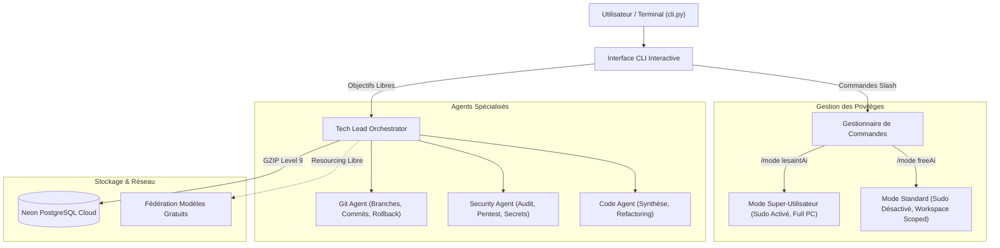

# Guide d'Utilisation Officiel - FreeAI Sovereign Assistant ⚡

Bienvenue dans le guide complet de **FreeAI**, l'assistant d'ingénierie et d'automatisation autonome souverain, conçu pour fonctionner en local avec resourcing libre dynamique et persistance cloud zéro-disque.

---

## 1. Introduction et Philosophie

FreeAI a été conçu selon des principes stricts de souveraineté, de frugalité matérielle et de puissance d'action :

- **Souveraineté & Priorité Locale** : Exécution prioritaire sur CPU local avec modèles quantifiés et agents autonomes spécialisés.
- **Resourcing Hybride Libre** : En cas de besoin de connaissances externes, FreeAI consulte dynamiquement des modèles ouverts gratuits sans coût d'API.
- **Mode NÉANT (Zero-Disk Footprint)** : Aucun fichier d'historique ou de cache n'est écrit sur le disque local dans les répertoires `memory/` et `logs/`. Toutes les opérations locales restent en RAM éphémère.
- **Mémoire Déportée Neon Cloud** : La mémoire essentielle est automatiquement filtrée, compressée avec **GZIP (niveau 9)** et stockée à distance dans PostgreSQL Neon Cloud.
- **Contrôle Granulaire des Privilèges** : Bascule dynamique et instantanée entre un mode standard confiné (`freeAi`) et un mode super-utilisateur sans restriction (`lesaintAi`).



---

## 2. Démarrage Rapide

### Prérequis
- Système d'exploitation Linux (testé et optimisé sous Kali Linux / Debian)
- Python 3.10+
- Dépendances installées via `requirements.txt` (`rich`, `psycopg2`, `fastapi`, `psutil`, etc.)

### Lancer la Console Interactive
Pour démarrer la console interactive avec l'invite dynamique et l'autocomplétion des commandes :

```bash
python3 cli.py
```

### Lancer en Mode Super-Utilisateur dès le départ
```bash
python3 cli.py --mode lesaintAi
```

### Exécuter un Objectif Direct (Mode Batch)
Vous pouvez également passer un objectif direct en argument sans entrer dans la boucle interactive :

```bash
# Vérifier l'état en une ligne
python3 cli.py /status

# Exécuter une recherche directe
python3 cli.py "/search *.conf /etc"

# Transmettre un objectif libre au Tech Lead
python3 cli.py "Audit des dépendances du projet et détection des vulnérabilités"
```

---

## 3. Les Modes de Privilèges (`/mode`)

FreeAI intègre un système de permissions à deux niveaux modifiable à chaud, sans redémarrer le programme.

| Caractéristique | Mode Standard (`freeAi`) | Mode Super-Utilisateur (`lesaintAi` ⚡) |
| :--- | :--- | :--- |
| **Commande d'activation** | `/mode freeAi` | `/mode lesaintAi` |
| **Invite du terminal** | `[FreeAI:freeAi] > ` | `[FreeAI:lesaintAi ⚡] > ` |
| **Privilèges Sudo** | ❌ **Désactivé** (`ALLOW_SUDO=False`) | ✔ **Activé** (`ALLOW_SUDO=True`) |
| **Périmètre d'écriture** | Confiné au workspace (`WORKSPACE_ROOT`) | 🌐 Tout le disque dur du PC |
| **Périmètre de lecture** | 🌐 Lecture globale du PC autorisée | 🌐 Lecture globale du PC autorisée |
| **Cas d'usage** | Développement quotidien, audits, scripts, refactoring | Tâches d'administration, installation de paquets root, modifications réseau |

### Comment basculer :
```text
[FreeAI:freeAi] > /mode lesaintAi
⚡ MODE SUPER-UTILISATEUR ACTIVÉ (lesaintAi) ⚡
• Privilèges sudo déverrouillés (ALLOW_SUDO=True)
• Écriture et exécution totale sur tout le système sans restriction

[FreeAI:lesaintAi ⚡] > /mode freeAi
🛡 MODE STANDARD SÉCURISÉ ACTIVÉ (freeAi)
• Privilèges sudo désactivés (Sudo bloqué)
• Écriture confinée au workspace du projet
```

> [!WARNING]
> En mode `lesaintAi`, FreeAI dispose des droits administrateurs complets. Veillez à vérifier les actions demandées pour éviter toute altération involontaire de fichiers système.

---

## 4. Référence Complète des Commandes Slash

L'interface de commande supporte l'autocomplétion via la touche `Tab` ainsi que l'historique via les flèches haut/bas.

### 4.1 `/mode [freeAi|lesaintAi]`
Affiche le mode en cours ou bascule instantanément vers le mode spécifié.
```text
/mode
/mode freeAi
/mode lesaintAi
```

---

### 4.2 `/status`
Affiche en direct un tableau de bord exhaustif du système et des services :
- **Mode actif et permissions** (Sudo, Écriture, Lecture globale).
- **Consommation RAM du processus IA** vs budget (3500 MB) et limite dure (4000 MB).
- **RAM globale du PC** (utilisée, disponible, totale).
- **Charge CPU instantanée**.
- **Mode mémoire local** : confirmation du Mode NÉANT (0 octet écrit sur disque).
- **État de la base Neon Cloud** : statut de connexion, nombre d'enregistrements de connaissances et d'audits, algorithme de compression.

**Exemple de sortie :**
```text
                        📊 État Global du Système FreeAI                        
┏━━━━━━━━━━━━━━━━━━━━━━━┳━━━━━━━━━━━━━━━━━━━━━━━━━━━━━━━━━━━━━━━━━━━━━━━━━━━━━━┓
┃ Composant             ┃ Valeur / État                                        ┃
┡━━━━━━━━━━━━━━━━━━━━━━━╇━━━━━━━━━━━━━━━━━━━━━━━━━━━━━━━━━━━━━━━━━━━━━━━━━━━━━━┩
│ Mode Actif            │ freeAi (Standard Sécurisé)                           │
│ Privilèges Sudo       │ Désactivé (Sudo Bloqué)                              │
│ Périmètre Écriture    │ Confiné au Workspace                                 │
│ Lecture Globale PC    │ Autorisée                                            │
│ Workspace             │ /home/lesaint/Rendue/FreeAi                          │
│ RAM Processus IA      │ 69.9 MB / Budget: 3500 MB (Max: 4000 MB)             │
│ RAM Système           │ Utilisée: 4460 MB | Dispo: 3251 MB | Total: 7711 MB  │
│ CPU Système           │ 2.9 %                                                │
│ Mode Mémoire Local    │ NÉANT (0 octet écrit sur disque)                     │
│ Neon PostgreSQL Cloud │ Connecté - Connaissances: 7 | Audits: 51             │
│ Compression Mémoire   │ GZIP (Level 9) + Base64 ('gz:')                      │
└───────────────────────┴──────────────────────────────────────────────────────┘
```

---

### 4.3 `/search <motif> [dossier]`
Scanne l'ordinateur ou un répertoire cible pour trouver des fichiers pertinents (scripts, configurations, logs, sources).
- Exclut automatiquement les répertoires virtuels système (`/proc`, `/sys`, `/dev`, `/run`) et les dossiers volumineux (`node_modules`, `__pycache__`, `.venv`).
- Accepte les jokers (`*`, `?`).

**Exemples :**
```text
/search orchestrator.py
/search *.json /home/lesaint/Rendue
/search nginx.conf /etc
```

---

### 4.4 `/code <texte> [motif_fichier] [dossier]`
Recherche des fonctions, classes ou extraits de code dans les fichiers de l'ordinateur afin de retrouver une solution technique déjà implémentée.
- Ignore les fichiers supérieurs à 2 MB pour préserver la RAM.
- Affiche le nom du fichier, le numéro de ligne exact et l'extrait correspondant.

**Exemples :**
```text
/code def handle_objective
/code "class ToolGateway" *.py /home/lesaint/Rendue/FreeAi
/code psycopg2.connect
```

---

### 4.5 `/rollback`
Effectue une annulation Git immédiate des modifications non validées (`git reset --hard HEAD`).
- Très utile si une modification générée par un agent n'est pas satisfaisante.
- Préserve la propreté du dépôt en restaurant l'état du dernier commit.

**Exemple :**
```text
[FreeAI:freeAi] > /rollback
⏪ Exécution de l'annulation Git instantanée (git reset --hard HEAD)...
✔ Annulation Git effectuée avec succès ! Les modifications non validées ont été nettoyées.
HEAD is now at f7b4941 feat: implement dynamic mode switching
```

---

### 4.6 `/sync`
Force la synchronisation immédiate et la compression GZIP de la mémoire essentielle vers Neon PostgreSQL.
- Affiche la taille brute en octets, la taille compressée et le pourcentage de gain d'espace.

**Exemple :**
```text
[FreeAI:freeAi] > /sync
☁ Synchronisation et compression GZIP de la mémoire essentielle sur Neon PostgreSQL...
╭──────────────────────── ☁ Synchronisation Neon Cloud ────────────────────────╮
│ ✔ Synchronisation réussie !                                                  │
│                                                                              │
│ • Données brutes : 116 octets                                                │
│ • Taille compressée (GZIP) : 151 octets                                      │
│ • Gain d'espace : -30.2%                                                     │
│ • Mémoire essentielle compressée en GZIP et synchronisée sur Neon            │
│ PostgreSQL.                                                                  │
╰──────────────────────────────────────────────────────────────────────────────╯
```

---

### 4.7 `/help`
Affiche le tableau récapitulatif interactif de toutes les commandes disponibles.

---

### 4.8 `/clear`
Nettoie l'écran du terminal.

---

### 4.9 `/exit` ou `/quit`
Termine la session de travail et quitte le CLI proprement.

---

### 4.10 Entrée Textuelle Libre (Tech Lead Autonome)
Toute saisie ne commençant pas par un slash `/` est automatiquement interprétée comme un objectif d'ingénierie et transmise au **Tech Lead Orchestrator** :
1. FreeAI analyse l'intention (Code, Sécurité, ou Git).
2. Établit un plan de travail en plusieurs étapes.
3. Si des connaissances manquent, consulte la fédération de modèles en ligne gratuits.
4. Délègue l'exécution à l'agent spécialisé approprié.
5. Sauvegarde l'audit compressé dans Neon Cloud.

**Exemple :**
```text
[FreeAI:freeAi] > Analyse les vulnérabilités potentielles dans les routes FastAPI

╭────────────────────── 🚀 Exécution Tech Lead (freeAi) ───────────────────────╮
│ 🎯 Objectif : Analyse les vulnérabilités potentielles dans les routes FastAPI │
│ 🤖 Agent Assigné : SECURITY                                                  │
│ 🌐 Resourcing Externe : Non (100% Local)                                     │
│ ☁ Synchro Neon Cloud : Actif (GZIP)                                          │
│                                                                              │
│ 📋 Stratégie adoptée :                                                       │
│   • 1. Scan statique des points d'entrée et validateurs Pydantic.            │
│   • 2. Recherche de requêtes SQL brutes ou commandes shell non assainies.    │
│   • 3. Rapport d'audit et recommandations de mitigation.                     │
│                                                                              │
│ 📝 Résultat :                                                                │
│ Security audit passed. Aucun vecteur d'injection non filtré détecté.        │
╰──────────────────────────────────────────────────────────────────────────────╯
```

---

## 5. Recherche de Solutions sur Tout le PC

L'une des forces majeures de FreeAI est sa capacité à fouiller l'ordinateur en lecture globale (`allow_global_read=True`) pour réutiliser du code existant, des bibliothèques locales ou des scripts d'administration.

### Cas d'usage typiques :
1. **Trouver un module ou un fichier de configuration :**
   ```text
   /search settings.py
   /search *.pem /home/lesaint
   ```
2. **Trouver comment une API interne est consommée :**
   ```text
   /code "def sync_memory" *.py
   ```
3. **Résoudre une erreur d'import :**
   FreeAI peut localiser où se trouve le module manquant dans un autre projet sur le disque et vous proposer la bonne syntaxe.

---

## 6. La Mémoire NÉANT et la Compression GZIP vers Neon

### Pourquoi le Mode NÉANT ?
Sur des machines légères ou à stockage maîtrisé (comme le HP EliteBook sous Kali Linux), l'accumulation de logs volumineux ou de bases de données vectorielles locales dégrade les performances et encombre le disque.

FreeAI adopte une règle absolue :
- **0 octet écrit sur le disque local** dans `memory/` et `logs/`.
- En RAM, seules les données actives sont conservées et purgées automatiquement.

### Comment fonctionne la persistance Neon Cloud ?
Lorsque vous configurez `NEON_DATABASE_URL` dans votre fichier `.env` :
1. **Extraction de l'Essentiel** (`NeonMemoryManager.extract_essentials`) :
   Les traces verbeuses et superflues sont éliminées. Seuls le statut, l'agent, le message clé, les fichiers modifiés et les découvertes de sécurité sont conservés.
2. **Compression GZIP Maximale** :
   Le contenu JSON est compressé via `gzip` au niveau 9, puis encodé en Base64 avec l'en-tête `gz:`.
3. **Stockage Distant Déporté** :
   Les données sont envoyées à la base de données PostgreSQL Neon.
4. **Décompression Transparente** :
   À la lecture (`get_knowledge`), la mémoire est automatiquement décompressée à la volée.

---

## 7. Tableau Récapitulatif des Commandes

| Commande | Raccourci / Syntaxe | Description |
| :--- | :--- | :--- |
| **Changer de mode** | `/mode [nom]` | Bascule entre `freeAi` et `lesaintAi` |
| **Statut du système** | `/status` | Diagnostic RAM, CPU, Sudo, Neon |
| **Chercher un fichier** | `/search <motif> [dir]` | Recherche de fichiers sur le PC |
| **Chercher du code** | `/code <texte> [ext] [dir]` | Recherche de code dans les fichiers |
| **Rollback Git** | `/rollback` | Annulation immédiate (`git reset --hard`) |
| **Synchroniser Neon** | `/sync` | Compression GZIP et sauvegarde cloud |
| **Nettoyer l'écran** | `/clear` | Efface le terminal |
| **Aide** | `/help` | Affiche la liste des commandes |
| **Quitter** | `/exit` ou `/quit` | Ferme l'application |

---

## 8. Bonnes Pratiques & Sécurité

1. **Restez en mode `freeAi` par défaut** : Utilisez le mode `freeAi` pour toutes les tâches usuelles. N'activez `/mode lesaintAi` que lorsque vous avez expressément besoin de privilèges administrateur (`sudo`, installation de paquets système, configuration d'interfaces réseau).
2. **Vérifiez votre RAM avec `/status`** : Le watchdog veille automatiquement avec un seuil de dégradation à 3,5 GB et un arrêt d'urgence à 4,0 GB. Consulter `/status` vous permet de garder un œil sur la consommation réelle.
3. **Utilisez `/rollback` en cas de doute** : Si une modification de code ne correspond pas à vos attentes, le rollback instantané remet votre projet dans un état propre et fonctionnel.
4. **Configurez votre URL Neon** dans `.env` : Pour profiter de la mémoire persistante cloud sans consommer un seul mégaoctet de votre disque dur local.

---

*FreeAI Sovereign Assistant — Conçu pour l'autonomie, la liberté et l'excellence technique.*
