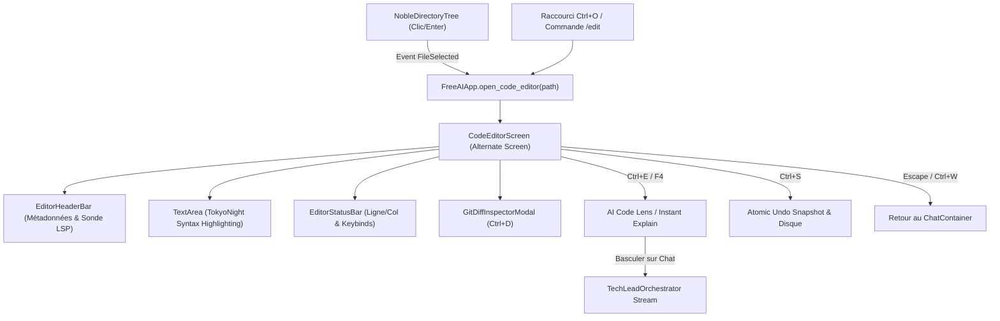

# Architecture Technique F-18 : Éditeur de Code Intégré In-TUI & Inspecteur Syntaxique Souverain

## 1. Vue d'Ensemble & Objectifs
La fonctionnalité F-18 dote FreeAI d'un environnement d'édition et d'inspection de code interactif de niveau IDE, directement au cœur du Full-Screen TUI Textual, sans quitter le terminal ni lancer d'outil lourd externe.



## 2. Composants Clés

### 2.1 `CodeEditorScreen(Screen)`
* **Cycle de vie** : Poussé sur la pile d'écrans de Textual via `app.push_screen(CodeEditorScreen(file_path))` et dépilé avec `app.pop_screen()` sur `Escape`.
* **EditorHeaderBar** :
  * Affiche le chemin relatif : `• Fichier : <path>`
  * Détection du langage : `[Lang: python | json | markdown | bash | etc.]`
  * Nombre de lignes et taille : `[N lignes · X Ko]`
  * Indicateur de modification en direct : `[✓ Synchronisé]` ou `[• Modifié *]`
  * Diagnostic LSP à chaud : `[• 0 LSP (Syntax OK)]` via `LiveLspProbe`.
* **TextArea Widget** :
  * Numéros de ligne affichés dans la gouttière gauche avec délimiteur `│`.
  * Support de la coloration syntaxique Textual (thème `monokai` ou `tokyo-night` adapté).
  * Sélection de code à la souris ou au clavier (`Shift+Flèches`).
  * Tabulation 4 espaces.
* **EditorStatusBar** :
  * Position du curseur : `Ln X, Col Y · UTF-8`
  * Barre d'aide aux touches : `ctrl+s save · ctrl+d diff · ctrl+e ai explain · esc close`

### 2.2 Touches d'Innovation Extrême

1. **AI Code Lens & Instant Explain (`F4` / `Ctrl+E`)** :
   * Si une sélection de texte est active dans le `TextArea`, elle est extraite ; sinon, l'intégralité du fichier est sélectionnée.
   * L'écran de l'éditeur se ferme ou bascule instantanément sur l'écran principal de conversation `MainScreen`.
   * Un prompt enrichi est formulé : `Analyse, explique et optimise ce code du fichier <path> :\n\n```<lang>\n<code>\n````.
   * La réponse commence à streamer immédiatement dans le `ChatContainer` avec bordure gauche `┃` et accordéon de pensée.

2. **Inline Git Diff Inspector (`Ctrl+D`)** :
   * Exécute un `git diff HEAD -- <file_path>` non-bloquant en RAM.
   * Affiche un écran modal ou tiroir dédié `GitDiffModal` montrant les différences exactes sous le format noble SplitBorder (`+` vert, `-` rouge, en-tête `@@`).
   * Permet de comparer les modifications non enregistrées ou locales avant de valider.

3. **Gouttière de Diagnostic LSP Temps Réel** :
   * Évalue le contenu du tampon via `LiveLspProbe(workspace_root)`.
   * Vérifie la conformité syntaxique sans dépendance externe lourde et remonte les erreurs dans le header.

4. **Sauvegarde Atomique Sécurisée & Frugale (`Ctrl+S`)** :
   * Avant toute écriture physique, un snapshot pré-sauvegarde est enregistré en RAM par `AtomicUndoManager` (F-14).
   * En cas d'erreur ou de regret, la commande `/undo` restaure instantanément la version précédente.
   * Respect strict des permissions : écriture confinée au workspace en mode `freeAi` ; écriture système permise en mode `lesaintAi`.

## 3. Conformité Zéro Émoji
Tous les symboles utilisés dans les widgets de l'éditeur sont strictement nobles :
`•`, `›`, `│`, `┃`, `╹`, `~`, `*`, `$`, `←`, `→`, `✱`, `◈`, `⊙`, `✓`, `✗`, `▣`. Zéro caractère Unicode émoji.
