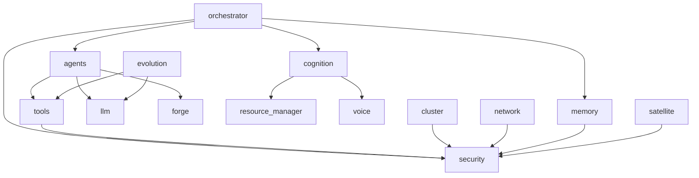

# Carte des packages

| Package | Chemin | Responsabilité | Depend de |
|---|---|---|---|
| agents | app/agents | Agents spécialisés de génération de code, git et sécurité | tools, llm, forge |
| cluster | app/cluster | Consensus distribué Raft éphémère, maillage P2P et pont ultrasonique | security |
| cognition | app/cognition | Flux de conscience synthétique réflexif et moteur ReAct Hermes | resource_manager, voice |
| evolution | app/evolution | Évolution autonome darwinienne du code et mises à jour souveraines | tools, llm |
| forge | app/forge | Passerelle bidirectionnelle avec Forge et Craft-Suite | agents |
| llm | app/llm | Moteur de fédération et routage LLM frugal (OpenRouter, Groq, Ollama) | security |
| memory | app/memory | Coffre chiffré Telegram Neural Vault, Hologramme 1-bit et persistance Neon | security |
| network | app/network | Passerelle Tor Onion V3 souveraine et points de terminaison masqués | security |
| orchestrator | app/orchestrator | Orchestrateur Tech Lead et routage autonome d'objectifs | agents, memory, cognition, security |
| resource_manager | app/resource_manager | Gestion frugale de la RAM (< 70 Mo) et budgets stricts | - |
| security | app/security | Sentinelle Sanctuaire de la Vie et sandbox d'exécution | - |
| satellite | app/satellite | Surveillance satellite globale et données spatiales temps réel | security |
| tools | app/tools | Passerelle d'exécution d'outils contraints, sandbox et pont d'audit peer-sync | security |
| voice | app/voice | Synthèse vocale native Linux TTS et reconnaissance Groq Whisper STT | - |

