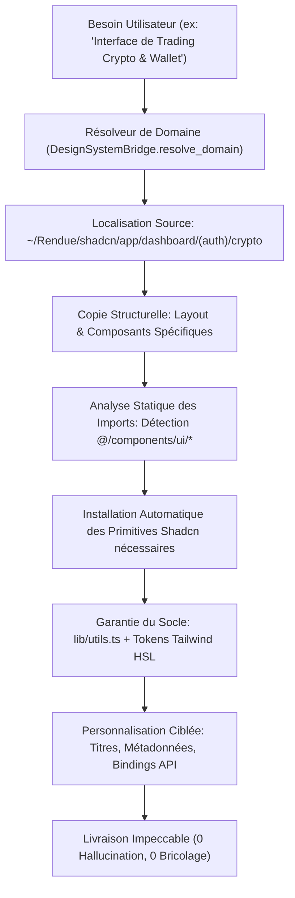

# Architecture UI/UX & Protocole d'Adaptation de Templates (Copy & Adapt)

## 1. Vision et Problématique Résolue

Historiquement, la génération d'interfaces par intelligence artificielle produit trop souvent des rendus génériques et artificiels : balises HTML brutes, feuilles de style incohérentes, layouts incohérents et absence d'ergonomie professionnelle.

Dans l'écosystème de développement du propriétaire, un trésor complet et vivant de composants et de tableaux de bord professionnels existe déjà dans le référentiel local :
```
/home/lesaint/Rendue/shadcn
```

Le module **UI/UX & Copy & Adapt Engine** de FreeAI garantit que le système :
1. **N'invente JAMAIS d'interface ex-nihilo** quand un template ou un composant métier existe en local.
2. **Identifie et extrait fidèlement** le template correspondant au domaine métier (Blockchain, Trading, IA, Mobile, CRM, E-Commerce, etc.).
3. **Applique le Protocole Copy & Adapt** : copie exacte de l'arborescence du dashboard, détection automatique des primitives UI Shadcn requises (`components/ui`), copie du fichier d'utilitaires `lib/utils.ts`, et adaptation ciblée des props, types et métadonnées.
4. **Intègre les micro-interactions et animations réelles** : `motion` (Framer Motion v12), `lottie-react` (sphère animée IA), `tailwindcss-animate`, `reactbeat` et `ai-elements`.

---

## 2. Matrice des Domaines Métiers Locaux (`~/Rendue/shadcn`)

| Clé Domaine | Répertoire Source Local | Composants Métiers Clés | Primitives Shadcn & Animations |
| :--- | :--- | :--- | :--- |
| **`crypto`** | `app/dashboard/(auth)/crypto` | `overview-card`, `digital-wallets`, `trading-card`, `recent-activities`, `chart-balance-summary` | `badge`, `button`, `card`, `chart`, `dropdown-menu`, `form`, `input`, `select`, `tabs` + `recharts`, `motion` |
| **`finance`** | `app/dashboard/(auth)/finance` | `kpi-cards`, `monthly-expenses`, `my-wallet`, `revenue`, `saving-goal`, `summary`, `transactions` | `card`, `chart`, `count-animation`, `table`, `tabs`, `button` |
| **`payment`** | `app/dashboard/(auth)/payment` | `balance-overview`, `exchange-rates`, `notification-banner`, `transaction-history` | `card`, `table`, `badge`, `button`, `sheet` |
| **`ai-chat`** | `app/dashboard/(auth)/apps/ai-chat-v2` | `ai-chat-interface`, `ai-chat-sidebar`, `ai-upgrade-modal`, `ai-sphere-animation.json` | `dialog`, `dropdown-menu`, `input`, `select`, `sheet`, `lottie-react`, `ai-elements` |
| **`ai-image`** | `app/dashboard/(auth)/apps/ai-image-generator` | `image-generator`, `image-generator-form`, `image-gallery`, `history-sheet` | `form`, `card`, `dialog`, `sheet`, `slider`, `motion` |
| **`ecommerce`** | `app/dashboard/(auth)/ecommerce` | `best-selling-products`, `customer-reviews`, `new-customers`, `recent-orders`, `return-rate`, `stat-cards` | `table`, `card`, `chart`, `badge`, `avatar`, `tabs` |
| **`crm`** | `app/dashboard/(auth)/crm` | `leads`, `leads-by-source`, `recent-tasks`, `sales-pipeline`, `target-card`, `total-deals` | `card`, `chart`, `table`, `badge`, `avatar`, `dnd-kit` |
| **`project-management`**| `app/dashboard/(auth)/project-management`| `chart-project-efficiency`, `reminders`, `reports`, `success-metrics`, `summary-cards`, `table-recent-projects` | `table`, `calendar`, `chart`, `dialog`, `badge`, `progress` |
| **`mobile-tasks`** | `app/dashboard/(auth)/apps/tasks` | Ergonomie tactile, drawres bas d'écran Vaul, navigation mobile | `sheet`, `drawer`, `vaul`, `use-mobile` |
| **`analytics`** | `app/dashboard/(auth)/website-analytics` | `average-daily-sales`, `earning-reports-card`, `monthly-campaign-state`, `sales-by-countries-card` | `card`, `chart`, `table`, `badge`, `recharts` |

---

## 3. Le Protocole Copy & Adapt



---

## 4. Rôle de l'Agent `UiUxAgent`

L'`UiUxAgent` (`app/agents/ui_ux_agent.py`) est l'architecte frontend et le garant esthétique de FreeAI :
- **Intégration au Tech Lead Orchestrator** : activé immédiatement lors de toute consigne relative aux interfaces, dashboards, templates ou au design system.
- **Assistance Persona Haute Innovation** : allie la rigueur de reproduction des templates locaux avec la vision d'innovation extrême (Jarvis / Michael).
- **Ligne de Commande Souveraine (`/ui` et `/design`)** :
  - `/ui templates` : affiche la grille des dashboards métiers disponibles.
  - `/ui inspect <domaine>` : inspecte les fichiers, les composants et les primitives requises.
  - `/ui adapt <domaine> <dossier> [titre]` : déploie le template et ses composants sans hallucination.
  - `/ui catalog` : catalogue des 61+ composants shadcn UI.
  - `/ui export` : compression GZIP en RAM et téléversement vers le Telegram Neural Vault.
